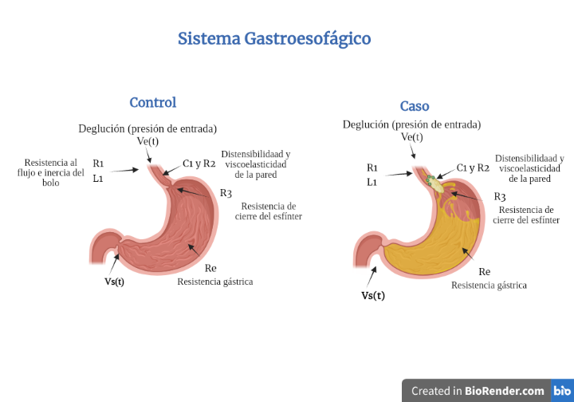
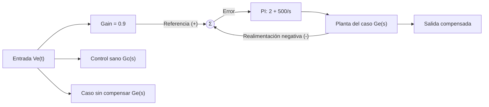
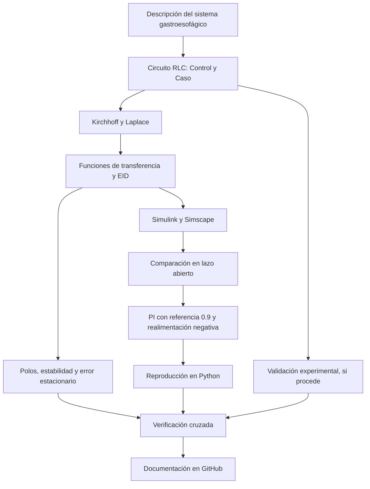

[](https://matlab.mathworks.com/open/github/v1?repo=Alexa-Montano/MSF-Proyecto)


# Proyecto final — Modelado y control del sistema gastroesofágico

Repositorio académico de la asignatura **Modelado de Sistemas Fisiológicos**, del programa de **Ingeniería Biomédica** del Tecnológico Nacional de México / Instituto Tecnológico de Tijuana. El proyecto integra el modelado fenomenológico mediante analogías eléctricas RLC de segundo orden, análisis matemático, simulación computacional y diseño de un controlador PI para comparar una condición sana (**Control**) con una condición patológica (**Caso: reflujo gastroesofágico**).

**Docente:** Dr. Paul Antonio Valle Trujillo  
**Correo:** paul.valle@tectijuana.edu.mx  
**Departamento:** Ingeniería Eléctrica y Electrónica  
**Institución:** Tecnológico Nacional de México / Instituto Tecnológico de Tijuana  
**Asignatura:** Modelado de Sistemas Fisiológicos (IBF-1020)  
**Programa:** Ingeniería Biomédica  
**Sede:** Blvd. Alberto Limón Padilla s/n, Tijuana, C. P. 22454, B. C., México.

### Integrantes

| Nombre | Número de control |
| --- | --- |
| Mildred Angel Torales | 23212731 |
| Alexa Montaño Gómez | 23212215 |
| Africa Montserrat Rodriguez Garcia | C21211891 |

## Contenido

1. [Resumen](#resumen)
2. [Competencia y objetivos](#competencia-y-objetivos)
3. [Relación con el temario](#relación-con-el-temario)
4. [Modelo físico y analogía eléctrica](#modelo-físico-y-analogía-eléctrica)
5. [Formulación matemática](#formulación-matemática)
6. [Análisis temporal y de estabilidad](#análisis-temporal-y-de-estabilidad)
7. [Señal de entrada y condiciones de simulación](#señal-de-entrada-y-condiciones-de-simulación)
8. [Implementación en MATLAB, Simulink y Simscape](#implementación-en-matlab-simulink-y-simscape)
9. [Control en lazo cerrado y sintonización PID](#control-en-lazo-cerrado-y-sintonización-pid)
10. [Reproducción en Python](#reproducción-en-python)
11. [Controlador analógico y laboratorio](#controlador-analógico-y-laboratorio)
12. [Resultados y verificación cruzada](#resultados-y-verificación-cruzada)
13. [Flujo de trabajo](#flujo-de-trabajo)
14. [Actividades del equipo](#actividades-del-equipo)
15. [Estructura del repositorio](#estructura-del-repositorio)
16. [Requisitos](#requisitos)

## Resumen

Se desarrolla un modelo eléctrico equivalente del sistema gastroesofágico para estudiar diferencias dinámicas entre una condición sana y una condición con reflujo. Se emplean resistencias, una inductancia y una capacitancia para representar fenomenológicamente disipación, inercia y almacenamiento. Las leyes de Kirchhoff y la transformada de Laplace permiten obtener ecuaciones integro-diferenciales y funciones de transferencia. Se comparan las respuestas mediante Simscape, bloques de función de transferencia, integradores en Simulink y Python. El controlador PI utiliza una referencia escalada de 0.9 para obtener una salida compensada ligeramente superior a la del caso durante la parte sostenida del estímulo.

El circuito es una analogía académica, no un modelo clínicamente validado ni una propuesta de tratamiento médico.

**Palabras clave:** Sistema gastroesofágico; Reflujo gastroesofágico; Analogía eléctrica RLC; Control y caso; PI; MATLAB; Simulink; Simscape; Python.

[Volver al contenido](#contenido)

## Competencia y objetivos

### Competencia a desarrollar

Modelizar sistemas fisiológicos mediante analogías eléctricas, ecuaciones diferenciales y funciones de transferencia; analizar estabilidad y respuesta temporal, y aplicar estrategias de control clásico retroalimentado.

### Objetivo general

Formular y simular un modelo dinámico de segundo orden del sistema gastroesofágico en condiciones sana y patológica, e implementar un controlador PI que modifique la respuesta del caso conforme a la referencia de diseño.

### Objetivos específicos

- Proponer el circuito equivalente y establecer los parámetros de ambas condiciones.
- Obtener las ecuaciones integro-diferenciales y las funciones de transferencia mediante Kirchhoff y Laplace.
- Calcular polos, ceros, estabilidad y error estacionario.
- Comparar las representaciones eléctricas y matemáticas en Simulink y Python.
- Implementar la realimentación negativa con un controlador PI y referencia escalada.
- Documentar resultados y evidencias reproducibles en GitHub.

[Volver al contenido](#contenido)

## Relación con el temario

| Unidad | Área | Contenidos aplicados |
| --- | --- | --- |
| I | Sistemas de control retroalimentados | Diagramas de bloques, error, respuesta temporal y estabilidad. |
| II | Modelado matemático | Kirchhoff, Laplace, ecuaciones integro-diferenciales y funciones de transferencia. |
| III | Controladores | Diseño PI, realimentación negativa y seguimiento de referencia. |

[Volver al contenido](#contenido)

## Modelo físico y analogía eléctrica

El esófago transporta el bolo alimenticio hacia el estómago; la barrera antirreflujo, que incluye el esfínter esofágico inferior, contribuye a limitar el retorno del contenido gástrico. El modelo representa de forma simplificada las diferencias de comportamiento entre las dos condiciones mediante parámetros eléctricos equivalentes, sin asignarles valores fisiológicos medidos.

### Representación fisiológica (BioRender)



### Topología del circuito equivalente

La fuente $V_e(t)$ alimenta una rama en serie formada por $R_1$ y $L_1$. En el nodo siguiente se conectan dos ramas hacia referencia: una formada por $C_1$ y $R_2$ en serie y otra por $R_3$ y $R_e$ en serie. La salida $V_s(t)$ se mide sobre $R_e$.

### Parámetros del modelo

| Componente | Control (sano) | Caso (reflujo) |
| --- | ---: | ---: |
| $R_1$ | 10 kΩ | 10 kΩ |
| $L_1$ | 1 µH | 1 µH |
| $R_2$ | 10 kΩ | 10 kΩ |
| $C_1$ | 50 µF | 10 µF |
| $R_3$ | 100 kΩ | 10 kΩ |
| $R_e$ | 10 kΩ | 150 kΩ |

[Volver al contenido](#contenido)

## Formulación matemática

### 1. Ecuaciones integro-diferenciales

Sean $i_1$ la corriente de la rama principal, $i_2$ la corriente por $R_3$ y $R_e$, y $q_C$ la carga del capacitor. Con condiciones iniciales nulas:

$$
V_e=R_1 i_1+L_1\frac{di_1}{dt}+(R_3+R_e)i_2
$$

$$
(R_3+R_e)i_2=R_2(i_1-i_2)+\frac{1}{C_1}\int_0^t(i_1-i_2)\,d\tau
$$

$$V_s=R_e i_2$$

### 2. Representación mediante integradores (EID)

$$
\frac{di_1}{dt}=\frac{V_e-R_1i_1-(R_3+R_e)i_2}{L_1}
$$

$$\frac{dq_C}{dt}=i_1-i_2,\qquad V_C=\frac{q_C}{C_1}$$

$$i_2=\frac{V_C+R_2i_1}{R_2+R_3+R_e}$$

Estas expresiones permiten implementar el modelo mediante sumadores, ganancias e integradores en Simulink.

### 3. Función de transferencia general

Aplicando Laplace con condiciones iniciales nulas y eliminando las corrientes:

$$
G(s)=\frac{V_s(s)}{V_e(s)}=\frac{R_e R_2 C_1s+R_e}{a_2s^2+a_1s+a_0}
$$

$$a_2=L_1 C_1(R_2+R_3+R_e)$$

$$a_1=L_1+R_1 C_1(R_2+R_3+R_e)+R_2 C_1(R_3+R_e)$$

$$a_0=R_1+R_3+R_e$$

### 4. Condición Control (sano)

$$G_c(s)=\frac{5000s+10000}{6\times10^{-6}s^2+115000.000001s+120000}$$

### 5. Condición Caso (reflujo)

$$G_e(s)=\frac{15000s+150000}{1.7\times10^{-6}s^2+33000.000001s+170000}$$

[Volver al contenido](#contenido)

## Análisis temporal y de estabilidad

Los polos se obtienen de las raíces del denominador. Ambas plantas presentan dos polos reales negativos y son estables, con modos naturales sobreamortiguados. Los ceros también influyen en la forma de las respuestas.

| Parámetro | Control | Caso |
| --- | ---: | ---: |
| Polo rápido | −1.916667 × 10¹⁰ | −1.941176 × 10¹⁰ |
| Polo lento | −1.043478 | −5.151515 |
| Cero | −2 | −10 |
| Ganancia estática | 0.083333 | 0.882353 |
| Estabilidad | Estable | Estable |

### Error en estado estacionario

Para un escalón unitario sostenido y sistemas estables, por el teorema del valor final:

$$e_{ss}=\lim_{s\to0}sE(s)=1-G(0)$$

$$e_{ss,c}=1-\frac{10000}{120000}=0.916667\;\mathrm{V}$$

$$e_{ss,e}=1-\frac{150000}{170000}=0.117647\;\mathrm{V}$$

La diferencia entre las salidas estacionarias del caso y el control es:

$$\Delta V_s=|0.882353-0.083333|=0.799020\;\mathrm{V}$$

Estos valores corresponden al escalón sostenido, no al valor final del pulso, cuyas respuestas estables regresan a cero.

[Volver al contenido](#contenido)

## Señal de entrada y condiciones de simulación

| Parámetro | Especificación |
| --- | --- |
| Entrada | Pulso unitario de 1 V |
| Inicio y fin del pulso | 1 s y 2 s |
| Intervalo | 0–10 s |
| Paso de muestreo en Python | 0.001 s |
| Condiciones iniciales | Nulas |

$$V_e(t)=u(t-1)-u(t-2)$$

[Volver al contenido](#contenido)

## Implementación en MATLAB, Simulink y Simscape

El modelo corregido se encuentra en [`MSF_Proyecto_PID_09.slx`](MSF_Proyecto_PID_09.slx). Se consideran las representaciones mediante circuito eléctrico (Simscape), función de transferencia (Transfer Fcn) y ecuaciones integro-diferenciales (EID). El Scope del caso permite comparar las respuestas y la salida compensada. El cuaderno `Proyecto_SistGastro.mlx` constituye material de trabajo para el análisis en MATLAB; debe mantenerse sincronizado con el nombre y configuración del modelo final.

[Volver al contenido](#contenido)

## Control en lazo cerrado y sintonización PID

El bloque PID se configura como PI, con $K_P=2$, $K_I=500$ y $K_D=0$:

$$C(s)=2+\frac{500}{s}=\frac{2s+500}{s}$$

La referencia corregida es $r(t)=0.9V_e(t)$ y el error se define como:

$$e(t)=0.9V_e(t)-V_{s,PI}(t)$$



La función de transferencia desde la referencia hasta la salida es:

$$H(s)=\frac{C(s)G_e(s)}{1+C(s)G_e(s)}$$

$$H(s)=\frac{30000s^2+7800000s+75000000}{1.7\times10^{-6}s^3+63000.000001s^2+7970000s+75000000}$$

Desde la entrada original, la función compensada es $G_{PI}(s)=0.9H(s)$:

$$G_{PI}(s)=\frac{27000s^2+7020000s+67500000}{1.7\times10^{-6}s^3+63000.000001s^2+7970000s+75000000}$$

Polos del lazo cerrado: −3.705882 × 10¹⁰, −116.268951 y −10.238986. El sistema es estable. Para una entrada escalón unitario sostenida, la salida compensada tiende a 0.9 V; el error respecto a la referencia escalada es cero y respecto a la entrada original es 0.1 V. La diferencia estacionaria respecto al caso sin compensar es 0.017647 V. El objetivo de esta configuración es la comparación solicitada de las curvas, no reproducir la salida del sistema sano.

[Volver al contenido](#contenido)

## Reproducción en Python

La simulación independiente utiliza NumPy, SciPy, Matplotlib y python-control. Se calculan las funciones de transferencia y los polos y se obtienen las respuestas al pulso por diferencia de dos respuestas al escalón. Para reproducir la configuración final, la salida compensada debe calcularse con `PI = pulso(0.9*nh, dh)`, donde `nh` y `dh` son los coeficientes de $H(s)$.

```bash
pip install numpy scipy matplotlib control
python Montano23212215_Proyecto_Gastro.py
```

Antes de ejecutar, comprobar que el script incorpora la referencia 0.9 y no la función de transferencia del control sano como prefiltro. La gráfica puede exportarse como `Control_y_caso.python.pdf` y `Control_y_caso.python.png`.

[Volver al contenido](#contenido)

## Controlador analógico y laboratorio

Como propuesta de implementación analógica del PI, para una topología inversora con resistencia de entrada y realimentación RC en serie (considerando la inversión de signo en el lazo):

$$K_P=\frac{R_r}{R_{in}},\qquad K_I=\frac{1}{R_{in}C_r}$$

| Componente | Valor calculado |
| --- | ---: |
| $C_r$ | 1 µF |
| $R_{in}$ | 2 kΩ |
| $R_r$ | 4 kΩ |

La ganancia de referencia 0.9 requiere una etapa adicional. El montaje físico y las mediciones de osciloscopio deberán documentarse si se realizan; no se presentan aquí como resultados experimentales confirmados.

[Volver al contenido](#contenido)

## Resultados y verificación cruzada

| Señal | Valor estacionario ante escalón sostenido |
| --- | ---: |
| Entrada (rojo) | 1 V |
| Caso compensado PI (azul) | 0.900000 V |
| Caso (amarillo) | 0.882353 V |
| Control sano (verde) | 0.083333 V |

Durante el pulso, se espera que la salida compensada se aproxime a 0.9 V y quede por encima del caso en la parte sostenida del estímulo. La separación durante los transitorios depende de la dinámica de cada sistema.

| Plataforma / Escenario | Evidencia generada |
| ----- | ----- |
| **Análisis matemático** | [Análisis matemático proyecto MSF.pdf](An%C3%A1lisis%20matem%C3%A1tico%20proyecto%20MSF.pdf) |
| **MATLAB / Simulink / Simscape** | [MSF_Proyecto_Angel_Montano_Rodriguez.slx](MSF_Proyecto_Angel_Montano_Rodriguez.slx) |
| **Cuaderno interactivo MATLAB** | [Proyecto_SistGastro.mlx](Proyecto_SistGastro.mlx) |
| **Código Python** | [Sistema_Gastro.py](Sistema_Gastro.py) |
| **Resultados Python (PDF)** | [Control_y_caso.python.pdf](Control_y_caso.python.pdf) |
| **Resultados Python (PNG)** | [Control_y_caso.python.png](Control_y_caso.python.png) |
| **Modelo fisiológico BioRender** | [Sistema_Digestivo_BIORENDER.png](Sistema_Digestivo_BIORENDER.png) |

[Volver al contenido](#contenido)

## Flujo de trabajo



[Volver al contenido](#contenido)

## Actividades del equipo

- [x] Propuesta del circuito equivalente y parámetros de Control y Caso.
- [x] Formulación de funciones de transferencia y EID.
- [x] Cálculo de polos, estabilidad y error estacionario.
- [x] Diseño del PI y ajuste de referencia.
- [ ] Verificación final de las curvas en Simulink y Python con la configuración corregida.
- [ ] Incorporación de evidencias de laboratorio, si corresponde.
- [ ] Organización y publicación final de archivos en GitHub.

[Volver al contenido](#contenido)

## Estructura del repositorio

```
.
├── Análisis matemático proyecto MSF.pdf
├── CITATION.cff
├── Control_y_caso.python.pdf
├── Control_y_caso.python.png
├── LICENSE
├── MSF_Proyecto_Angel_Montano_Rodriguez.slx
├── MSF_Proyecto_Angel_Montano_Rodriguez.slx.autosave
├── Proyecto_SistGastro.mlx
├── README.md
├── Sistema_Digestivo_BIORENDER.png
└── Sistema_Gastro.py
```

[Volver al contenido](#contenido)

## Requisitos

- MATLAB y Simulink, con Simscape, Simscape Electrical y Control System Toolbox según la implementación.
- Python 3.x con `numpy`, `scipy`, `matplotlib` y `control`.
- Git / GitHub.

[Volver al contenido](#contenido)
